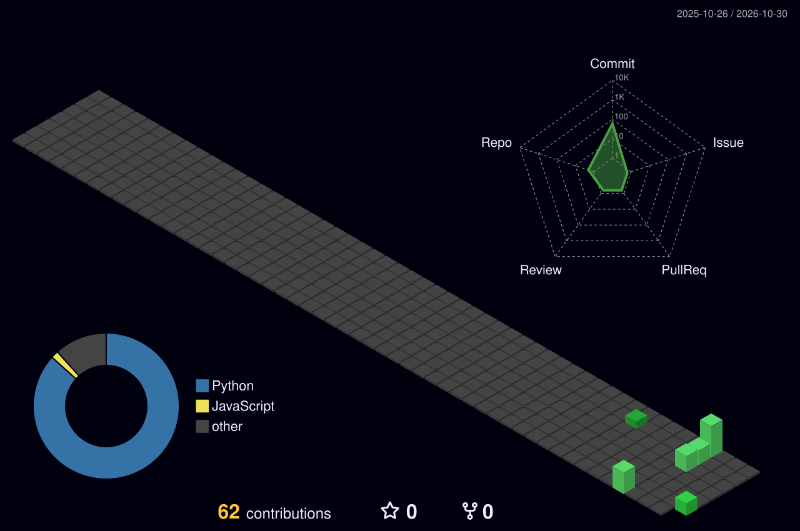

<div align="center">


<a href="https://github.com/rolan-lab">
  
</a>

<br/>


</div>

---

## `> cat about_me.txt`

```yaml
role:      Computer Science student
focus:     [cybersecurity, LLM security, digital forensics, robotics security]
currently: building an LLM prompt-injection testing harness
learning:  [operating systems, algorithms, web dev, TryHackMe paths]
os:        CachyOS + Hyprland
```

---

## 🏙️ The city I built this year

<div align="center">
<picture>
  <source media="(prefers-color-scheme: dark)" srcset="./profile-3d-contrib/profile-night-green.svg" />
  <source media="(prefers-color-scheme: light)" srcset="./profile-3d-contrib/profile-green-animate.svg" />
  
</picture>
</div>

---

## 📊 `> stats.scan_`

<div align="center">
  
  
</div>

<div align="center">
  
</div>

---

## 🛠️ Tech stack

<div align="center">

**Languages**<br/>


**Security & Systems**<br/>


**Cloud, AI & Hardware**<br/>


</div>

---

## 📂 `> ./projects.sh --pinned`

| Project | What it does | Tags |
|---|---|---|
| 🛡️ **llm-inject-harness** | Automated prompt-injection testing for LLM apps | `ai-security` `red-team` `python` |
| 🌙 **Lyra** | My personal AI operating system | `ai` `assistant` `automation` |
| 🔍 **forensic-timeline-toolkit** | Builds timelines and correlates forensic artifacts | `dfir` `forensics` `python` |
| 🤖 **esp32-desk-ai** | A tiny voice AI assistant that lives on my desk | `esp32` `iot` `hardware` |

---

## 🏅 Certifications & Training

<div align="center">


</div>

---

## 🐍 Watch the snake eat my contributions

<div align="center">
<picture>
  <source media="(prefers-color-scheme: dark)" srcset="https://raw.githubusercontent.com/rolan-lab/rolan-lab/output/github-snake-dark.svg" />
  
</picture>
</div>

---


